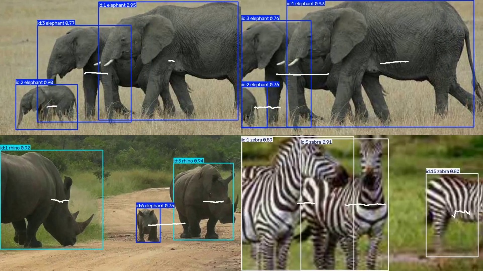
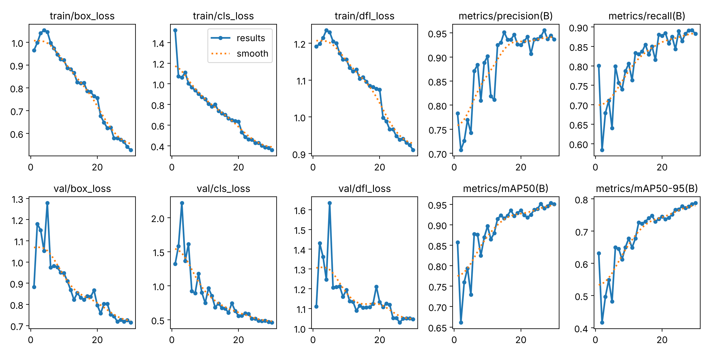
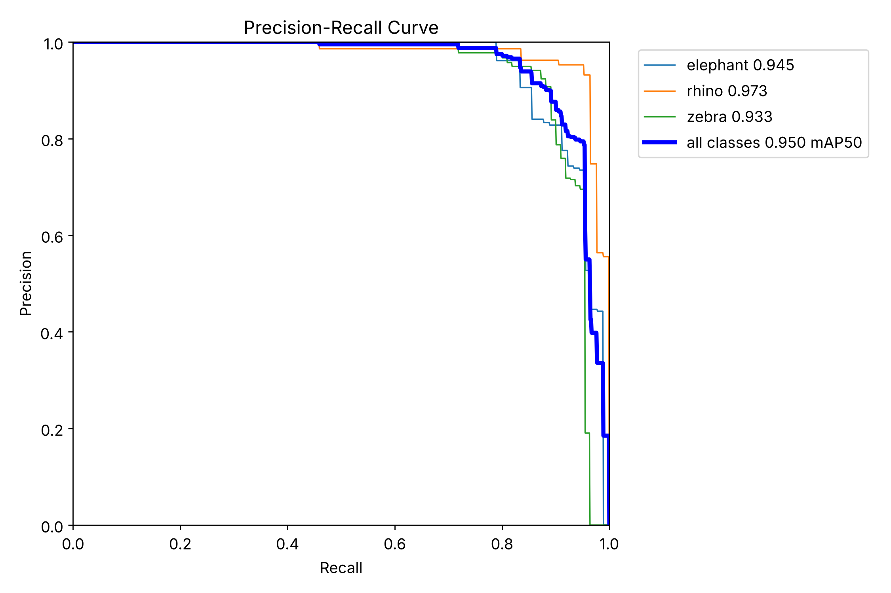
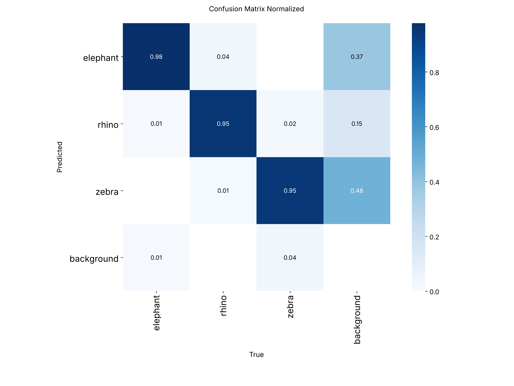

# YOLOv8 3-Class Fine-tuning: Elephant · Rhino · Zebra

충북대학교 머신러닝(이건명 교수님) 과제 — YOLO 모델을 3개 부류 데이터로 fine-tuning하고, 학습된 모델로 동영상 객체 탐지·추적 수행



## 1. 개요
| 항목 | 내용 |
|---|---|
| 모델 | YOLOv8n (Ultralytics), COCO 사전학습 가중치에서 전이학습 |
| 부류 (3) | `0: elephant`, `1: rhino`, `2: zebra` |
| 데이터 | Ultralytics African Wildlife 데이터셋에서 3개 부류만 추출 (총 1,125장) |
| 학습 환경 | CPU 2코어 (GPU 없음), 30 epochs, imgsz 416, batch 16 → 약 1.05시간 |
| 추적기 | ByteTrack (`model.track`) + 객체별 이동 궤적 표시 |

## 2. 데이터셋
원본 African Wildlife 데이터셋(buffalo, elephant, rhino, zebra 4개 부류) 중 **buffalo를 제외한 3개 부류**를 사용했습니다.
buffalo가 포함된 이미지는 buffalo 라벨만 지우면 버팔로가 "배경"으로 학습되는 문제가 생기므로, 이미지 자체를 제외했습니다 (`scripts/prep.py`).

| split | 이미지 | elephant 박스 | rhino 박스 | zebra 박스 |
|---|---:|---:|---:|---:|
| train | 784 | 557 | 396 | 565 |
| val | 163 | 90 | 85 | 110 |
| test | 178 | 99 | 75 | 135 |
| **합계** | **1,125** | 746 | 556 | 810 |

라벨 형식: YOLO txt (`class x_center y_center width height`, 0~1 정규화)

## 3. 학습 결과


| epoch | box loss (train) | cls loss (train) | Precision | Recall | mAP50 | mAP50-95 |
|---:|---:|---:|---:|---:|---:|---:|
| 1 | 0.965 | 1.519 | 0.783 | 0.801 | 0.857 | 0.632 |
| 5 | 1.046 | 1.004 | 0.743 | 0.640 | 0.729 | 0.482 |
| 10 | 0.922 | 0.852 | 0.901 | 0.806 | 0.897 | 0.677 |
| 20 | 0.756 | 0.635 | 0.925 | 0.878 | 0.935 | 0.746 |
| 30 | 0.527 | 0.360 | 0.936 | 0.883 | **0.950** | **0.788** |

### 최종 성능 (best.pt)
| 부류 | Val mAP50 | Val mAP50-95 | **Test mAP50** | **Test mAP50-95** |
|---|---:|---:|---:|---:|
| all | 0.950 | 0.788 | **0.974** | **0.811** |
| elephant | 0.945 | 0.777 | 0.981 | 0.787 |
| rhino | 0.973 | 0.832 | 0.990 | 0.890 |
| zebra | 0.933 | 0.756 | 0.950 | 0.757 |

Test: 학습·검증에 쓰지 않은 178장 / 309개 객체. 추론 속도 약 31.5 ms/img (CPU).

| PR 곡선 | 혼동 행렬 |
|---|---|
|  |  |

## 4. 객체 탐지 + 추적 동영상 (5초)
- 결과: [`video/tracking_result_5s.mp4`](video/tracking_result_5s.mp4) (960×540, 30fps, 150프레임)
- 입력 영상: test 이미지(학습 미사용) 3장에 카메라 패닝·줌인 효과를 준 5초 영상 (`scripts/make_video.py`)
- `model.track(persist=True, tracker="bytetrack.yaml")`로 프레임 간 객체 ID 유지, 객체 중심점 궤적(최근 30프레임)을 흰 선으로 표시 (`scripts/track.py`)

## 5. 실행 방법
```bash
pip install -r requirements.txt
# 1) 데이터: african-wildlife.zip을 받아 3개 부류로 변환 → datasets/wild3
python scripts/prep.py <african-wildlife 경로> datasets/wild3
# 2) 학습
python scripts/train.py
# 3) 추적 영상
python scripts/track.py weights/best.pt <입력영상.mp4> output.mp4
```

## 6. 저장소 구조
```
├── data.yaml              # 3개 부류 데이터셋 설정
├── weights/best.pt        # 학습된 모델
├── video/tracking_result_5s.mp4
├── results/               # 학습 곡선, PR/F1 곡선, 혼동 행렬, 예측 샘플
└── scripts/               # prep.py, train.py, make_video.py, track.py
```
